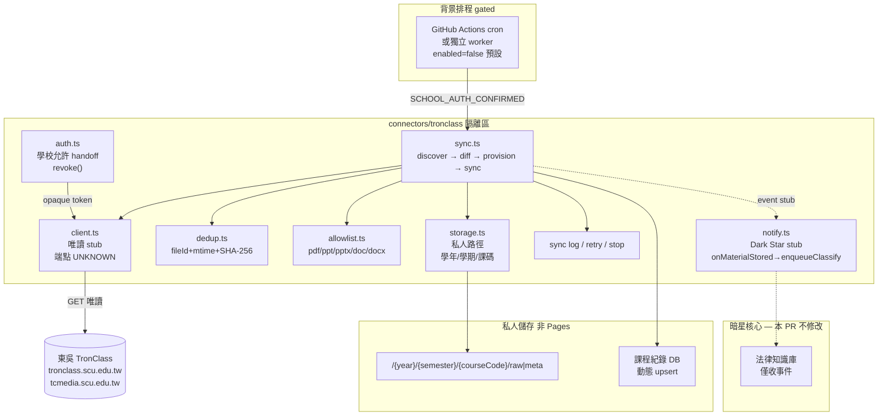

# TronClass Connector 架構

## 唯一目標

自動、唯讀同步課程教材 → 私人儲存（動態學期／課程）。

## 元件圖

## 資料流

1. **排程觸發**（6h）— 不依賴 UI／對話。  
2. **授權檢查** — 學校閘門 + opaque session；失敗則中止並記 log。  
3. **discoverCourses** — 取得目前學期課程清單（動態）。  
4. **diff** — 比對 DB 之學年度、學期、課程代碼（及 courseId）。  
5. **provision** — 新課：建立紀錄、私人目錄、索引槽；僅在 `accessAuthorized` 時啟用教材同步。  
6. **sync materials** — 列表 → allowlist → 教師允許下載 → 下載 → SHA-256 去重 → 寫入私人路徑。  
7. **notify** — 可選 stub 事件給暗星知識庫（預設關）。
7b. **enqueueClassify(materialMeta)** — 儲存成功後非阻塞 stub；分類 UI／邏輯由雙層分類分支負責；失敗不回滾檔案。  
8. **歷年教材** — 不刪、不混路徑；非本學期課可 `syncEnabled=false` 但仍保留檔案。

## 威脅模型（摘要）

| 威脅 | 緩解 |
|------|------|
| 憑證外洩 | 無明文密碼；revoke()；不寫入 git |
| 未授權自動化 | schoolAuthorizationConfirmed + env 雙閘 |
| 下載不可下載檔 | `downloadAllowed` 檢查；禁止繞過預覽 |
| 公開外洩教材 | 私人 root；禁止 Pages 路徑；本 PR 不部署公開產物 |
| 寫入 TronClass | client 僅設計 GET／下載；不實作突變 API |
| 供應鏈 | 不引入未審核 tronclass-api |
| 固定課表過期 | 動態 discover，禁止永久五門清單 |

## 隔離邊界

- 不修改 `dark-star-ebook.html`、正式首頁、既有 Actions 產線行為（僅新增 gated workflow）。  
- 暗星通知為介面 stub，無直接 DB 寫入正式知識庫。
