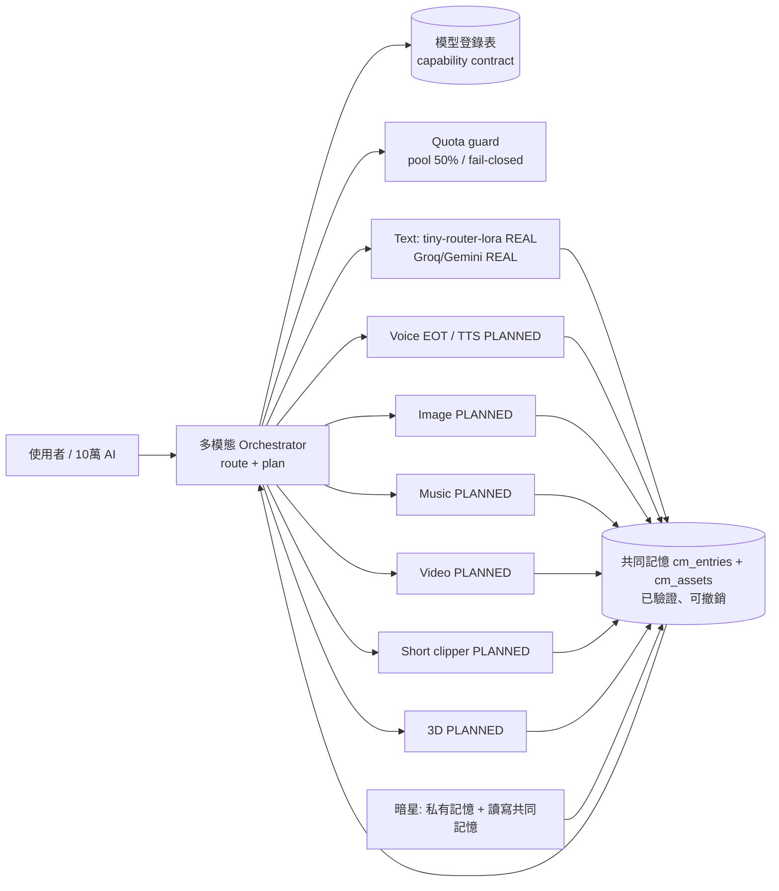
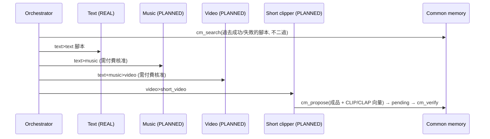

# AIVAULT 多模態預先設計 (v4) — 只是設計與 stub

標示：**REAL** = 已存在且已接上；**PLANNED** = 只有介面，沒有模型、沒有呼叫、沒有花費。旗標 `MULTIMODAL_ON` 預設關閉。

## 1. 整體架構

## 2. 管線範例：腳本 → 音樂 → 影片 → 短影音

## 3. 能力合約欄位
`id, status(real|planned), in[], out[], cost{unit,est}, quota(free_local|pool_50pct|paid_approval), device(cpu|gpu|api|edge), embed`。
路由順序：REAL 優先 → quota 低者優先 → 超過允許 quota 的步驟回傳 `blocked`（需要創辦人核准）。

## 4. 多模態共同記憶
`cm_assets`（在 `services/common-memory/sql/common_memory_v4.sql`）：每個 entry 可掛多個素材，
`emb_text vector(384)`（MiniLM，REAL）、`emb_image vector(512)`（CLIP-like，PLANNED）、`emb_audio vector(512)`（CLAP-like，PLANNED）、`emb_video vector(512)`（PLANNED）。
撤銷 entry 時，衍生的 lesson / adapter 訓練列一起失效（cascade）。
