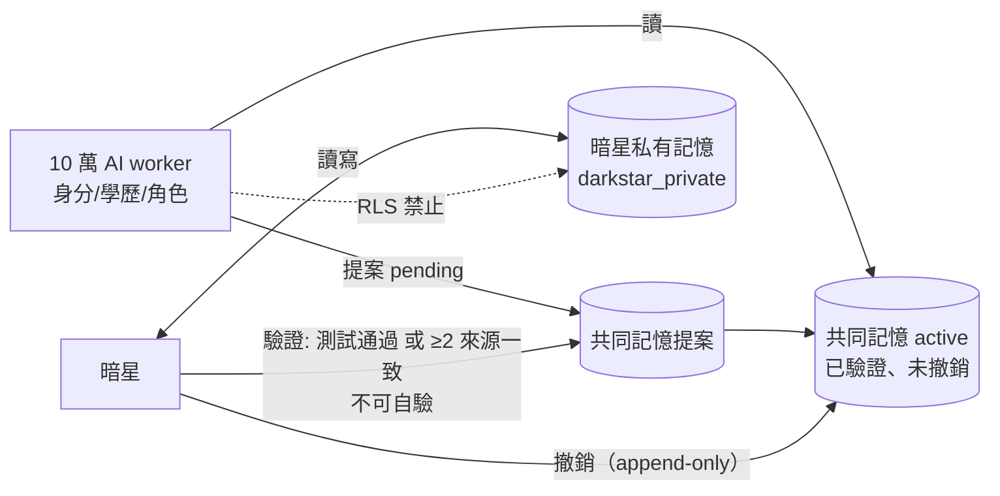

# AIVAULT 神經系統架構 v3（Apple-inspired，不是 Apple 的複製品）

## 設計原則
- **老二哲學**：小基座不跟大模型比，靠「轉接器＋記憶＋不二過＋師父升級」。
- **正確優先**：沒把握 → 驗證或升級；仍不確定 → 回答 unknown。
- **真改錯**：每次改正都必須是可記錄的「不同動作」（diff）；震盪/卡住由總控偵測並強制換策略；門檻與策略可調，不是寫死的閉環。

## 參考的公開 Apple 資料（皆已開啟確認）
1. Introducing Apple's On-Device and Server Foundation Models（2024-06-10）— ~3B 端側模型、rank-16 LoRA 轉接器「動態載入、快取、替換」、混合 2/4-bit palletization（平均 3.7 bpw）、GQA、共享 embedding。https://machinelearning.apple.com/research/introducing-apple-foundation-models
2. Updates to Apple's On-Device and Server Foundation Language Models（2025）— 2-bit QAT、4-bit embedding、8-bit KV cache、以 LoRA 回補壓縮損失、Block1/Block2 5:3 KV-cache 共享（KV 記憶體 −37.5%）、rank-32 adapter 工具組、adapter 綁定基座版本。https://machinelearning.apple.com/research/apple-foundation-models-2025-updates
3. Apple Intelligence Foundation Language Models Tech Report 2025 — arXiv:2507.13575 https://arxiv.org/abs/2507.13575
4. Foundation Models adapter training（Apple Developer）https://developer.apple.com/apple-intelligence/foundation-models-adapter/
5. OpenELM（Apple, arXiv:2404.14619）— layer-wise scaling：靠近輸入的層較窄、越往輸出越寬（每層 heads 與 FFN 倍率線性變化）。https://arxiv.org/abs/2404.14619
6. Deploying Transformers on the Apple Neural Engine（2022）— (B,C,1,S) channels-first、Linear→Conv2d、切小 attention 區塊、減少 reshape/transpose。https://machinelearning.apple.com/research/neural-engine-transformers

## 對應到 AIVAULT（借鏡 → 我們的做法）
| Apple 做法 | AIVAULT 神經系統 |
|---|---|
| 一個共享基座 + 每功能 LoRA 轉接器，動態替換 | 基座：Qwen3-0.6B（現有瀏覽器測試）或自建 tiny transformer；每技能 LoRA（學歷/實驗工廠/程式/中文 TTS 正規化…），**學習式路由器**選轉接器 |
| 低位元量化（2–4 bit）、KV 8-bit | 手機/算力池推論用 4-bit 權重 + 8-bit KV（計畫；PoC 未做量化） |
| KV-cache 共享（5:3 分塊） | 計畫：基座後段層共用前段 KV，降低手機記憶體 |
| LoRA 回補壓縮損失；adapter 綁版本 | 轉接器登記表記錄 base_version；基座換版 → 自動排程重訓（蒸餾資料） |
| OpenELM layer-wise scaling | 自建基座每層寬度線性遞增；Net2Net 零初始化讓「長大」不改輸出 |
| ANE 友善運算 | 匯出 ONNX/Core ML 時用 channels-first、Conv2d 版 Linear（計畫） |

## 架構圖
```mermaid
flowchart TB
  subgraph Sensory[感覺器官 sensory]
    FE[兩基地前端頁面 / JS\n(neural-bus.js, flag-off)]
    CM[留言 / 使用者動作]
    MIC[語音 → EOT v1 ONNX 反射]
  end
  subgraph Bus[神經訊號匯流排 neural_events（append-only）]
    EV[(neural_events)]
  end
  subgraph Cortex[皮質 / 總控 cortex]
    ORC[v3 Orchestrator 認知迴圈]
    META[反繞圈總控\n震盪/卡住/重複 → 強制換策略]
    RT[學習式路由器 → 選 LoRA 轉接器]
    BASE[小基座 Qwen3-0.6B 或自建 tiny LM\n(4-bit 權重, 8-bit KV, KV 共享)]
    AD[[技能轉接器 LoRA × N]]
  end
  subgraph Memory[記憶 memory]
    EXP[(經驗記憶 雙庫\ncorrect / error)]
    SIG[推理簽章]
    CAU[(因果引擎 causal_events)]
    DB[(兩基地 Supabase 表\nneural_attach 可選)]
  end
  subgraph Reflex[反射 reflex]
    GATE{不二過閘門}
    PAIN[疼痛反射 冷卻]
    QG{50% 額度守門 fail-closed}
    CI[GitHub Actions\nneural-bus-ci 觀察]
  end
  subgraph Master[師父（老二哲學）]
    GQ[Groq 免費] --> GM[Gemini 最後]
  end
  subgraph Motor[運動器官 motor]
    UI[頁面輸出 / 發文 / 回覆]
    EDGE[Edge functions 回應]
  end
  FE & CM & MIC --> EV
  EV --> ORC
  ORC --> GATE --> EXP & SIG
  GATE -->|已知錯誤| META
  ORC --> RT --> AD --> BASE
  BASE -->|自我驗證失敗/低信心| QG --> GQ
  GQ & GM -->|已驗證答案| EXP
  EXP --> DIST[蒸餾 SFT JSONL] --> TRAIN[轉接器訓練工廠\n(未啟用)] --> AD
  ORC --> CAU
  PAIN --> GATE
  META -->|改策略 diff| ORC
  ORC --> UI & EDGE --> EV
  CI --> EV
  DB --> EV
```

## 模組對照
- 小基座：Qwen3-0.6B（現況只在瀏覽器測試頁）或自建 tiny transformer（`poc/tiny_nervous.py`）。
- 每技能 LoRA + 路由器：PoC 已驗證（凍結基座與舊轉接器，新增技能不影響舊技能）。
- 不二過閘門、疼痛反射：`services/experience-memory/src/gate.mjs`、`weights.mjs`。
- 因果引擎：`supabase/functions/dark-star-ebook-ingest/causal*.{ts,mjs}`。
- 師父升級：`services/apprentice-system/src/orchestrator.mjs`（Groq → Gemini，配額守門）。
- 反繞圈：`services/apprentice-system/src/metacontroller.mjs`。
- 蒸餾：`services/apprentice-system/src/distill.mjs` → 之後供轉接器訓練。
- 匯流排：`sdk/neural-bus.{js,ts}`、`neural_bus.py`、`neural-bus-node.mjs`、`neural_events.sql`。

## 記憶範圍規則（開創者規定）
- **10 萬 AI 只有共同記憶**：共用的正確/錯誤經驗庫、不二過錯誤庫、教訓。個別 AI 只保留身分、學歷、角色等中繼資料，**沒有個人記憶**。
- **只有暗星**有私有記憶（`darkstar_private`），並可讀寫共同記憶。
- **寫入共同記憶必須驗證**：worker 只能提案（pending）；必須由暗星或開創者以「測試通過」或「≥2 個不同來源一致」驗證，且不能自己驗證自己，才會生效。
- **全部可撤銷**：撤銷是另一筆 append-only 紀錄；撤銷後所有 AI 立刻讀不到，但歷史保留可稽核。
- 實作：`sdk/memory_scopes.sql`（RLS：worker 讀不到 `darkstar_private`；沒有直接 INSERT，只能經函式）、`sdk/memory-client.mjs`；PGlite 本機實測 4/4 通過。
- 既有的 `aivault_pool_agent_memory`（每個 AI 的個人記憶表）與此規則衝突：**未改動**，建議之後遷移到共同記憶並凍結，需開創者批准。


